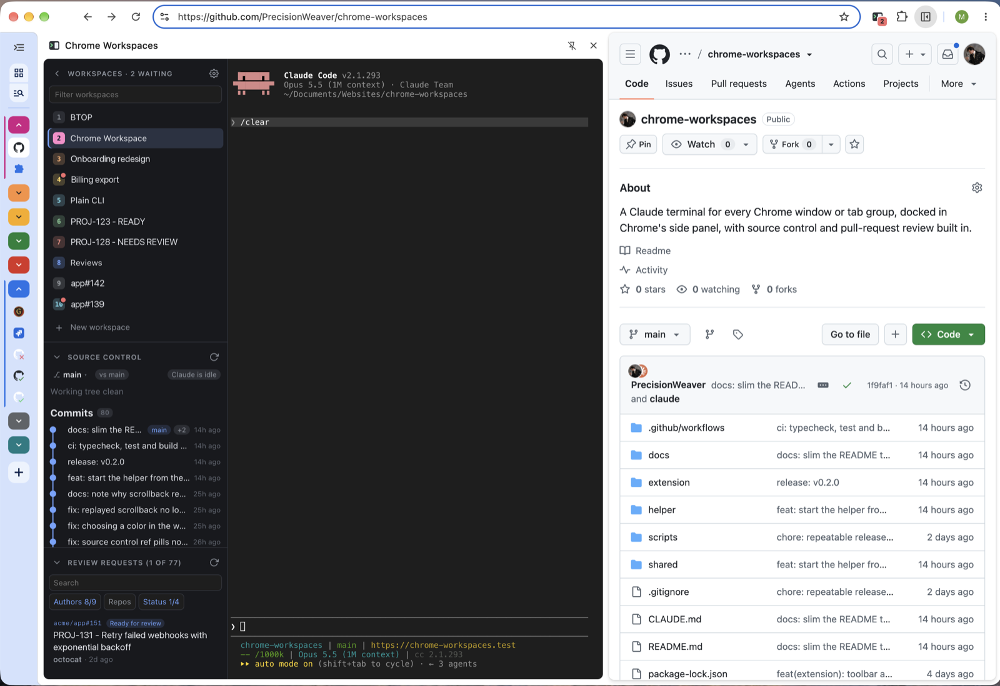

# Chrome Workspaces

[](https://github.com/PrecisionWeaver/chrome-workspaces/actions/workflows/release.yml)
[](https://github.com/PrecisionWeaver/chrome-workspaces/actions/workflows/ci.yml)

A Claude terminal for every Chrome window or tab group, docked in Chrome's side panel, with source control and pull-request review built in.

Each workspace is a regular Chrome window, or a tab group inside one, with your profile, logins, extensions, and DevTools, paired with a terminal running `claude`. Keep a task's tabs in its window or group and switch between workspaces with `⌃⇧←` / `⌃⇧→`.



## Highlights

- **A terminal per workspace**: closing the panel leaves `claude` running; reopening reattaches, and `exit` resumes the last conversation.
- **Source control built in**: branch, staged and unstaged changes, diffs, commit graph, CI status, and a commit box, following Claude into any git worktree.
- **Pull-request review**: open and requested PRs in a list; one click starts a workspace in the PR's repo with its details alongside.
- **Command palette** (`⌘K`), templates, status dots, desktop notifications, and an admin view with usage cost and process control.

All of it is in [docs/features.md](docs/features.md).

## Quick start

Requires macOS, Google Chrome, Node 24+ and Claude Code. `gh` is optional, for review requests.

```bash
npm install
npm run install-app -- --default-cwd ~/code --repo-root ~/code
```

That sets up, builds and starts the helper, then lists the Chrome steps: load `extension/dist` as an unpacked extension and click the toolbar icon. `npm run doctor` checks an install; `npm run uninstall` removes one. [docs/setup.md](docs/setup.md) has the details, and the HTTP API for scripting workspaces.

## Documentation

| Doc                                                            | Contents                                                            |
| -------------------------------------------------------------- | ------------------------------------------------------------------- |
| [docs/setup.md](docs/setup.md)                                 | Install, troubleshoot, run the helper, script workspaces, uninstall |
| [docs/features.md](docs/features.md)                           | Everything the panel does, and its limitations                      |
| [docs/configuration.md](docs/configuration.md)                 | `config.json` fields                                                |
| [docs/privacy.md](docs/privacy.md)                             | What leaves your machine, and what is kept                          |
| [docs/architecture.md](docs/architecture.md)                   | How the pieces fit, layout, security model                          |
| [docs/development.md](docs/development.md)                     | Commands, workflow, conventions                                     |
| [docs/releasing.md](docs/releasing.md)                         | Cutting a release                                                   |
| [CONTRIBUTING.md](CONTRIBUTING.md), [SECURITY.md](SECURITY.md) | Contributing, and reporting a vulnerability                         |

## License

[MIT](LICENSE)
